# 游戏启动脚本

双显卡笔记本上，游戏经常只跑在核显上。这个脚本把渲染交给 NVIDIA 独显，可选 Gamescope 锁帧和 MangoHud。它只在你自己的家目录里放一个命令，不改系统目录。

## 它做什么

- 加上 `__NV_PRIME_RENDER_OFFLOAD=1` 这一类变量，让独显来画
- Gamescope：1080p、144Hz、FSR
- MangoHud：占用、温度、功耗、帧数
- `doctor`：看驱动、Vulkan、游戏相关的包装了没有

## 安装

```bash
git clone https://github.com/shenchuchu91-hub/moe-game-launcher.git ~/.local/share/moe-game-launcher
cd ~/.local/share/moe-game-launcher
chmod +x install.sh
./install.sh
```

卸掉：

```bash
rm -f ~/.local/bin/moe-game
rm -rf ~/.local/share/moe-game-launcher
```

## 用

```bash
moe-game run -m /path/to/game.exe
moe-game run -g -m /path/to/game.exe
moe-game doctor
moe-game steam-options
```

`-m` 开 MangoHud。`-g` 再套一层 Gamescope。`steam-options` 打印一段可以贴进 Steam 启动选项的参数。

不管超频，不改显卡固件，也不往游戏里注入东西。许可是 [MIT](LICENSE)。

<p align="center"><sub>雨还在下</sub></p>


