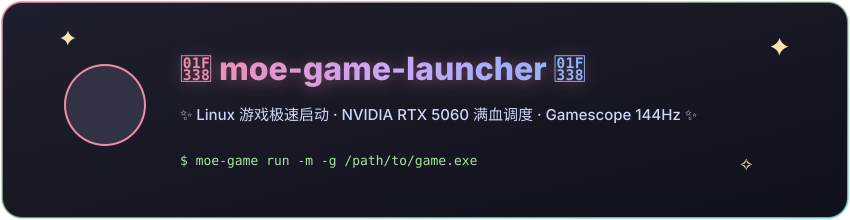

<div align="center">

  

  <br><br>

  <p align="center">
    
    
    
    
    
  </p>

  <p align="center">
    <i>🌸 专为 Linux 游戏本玩家打造的极速游戏启动器与独立显卡满血调度工具箱 🌸</i>
  </p>

</div>

---

## 🌟 核心特性 (Features)

- 󰢮 **强制 RTX 5060 满血调用**：自动注入 `Prime Offload` 变量，彻底解决混合显卡游戏本（Intel + NVIDIA）偷跑核显导致卡顿的痛点。
- 🖥️ **Gamescope 144Hz 极速匹配**：完美契合 144Hz 高刷屏幕，支持动态 FSR 超分辨率锐化与比例锁定。
- 🌸 **萌系二次元 MangoHud 皮肤**：内置粉紫暗夜霓虹主题，实时监视 GPU 占用、显存、核心温度、CPU 功耗与真实帧率。
- 🦆 **小黄鸭补帧兼容 (LSFG)**：无缝支持 Lossless Scaling 补帧环境注入。
- ⚡ **环境一键体检 (`doctor`)**：秒级检测电脑驱动状态、Vulkan 环境及游戏组件。

---

## 🚀 极速安装 (Quick Install)

打开终端运行以下命令：

```bash
git clone https://github.com/shenchuchu91-hub/moe-game-launcher.git ~/.local/share/moe-game-launcher
cd ~/.local/share/moe-game-launcher
chmod +x install.sh
./install.sh
```

---

## 🎮 使用指南 (Usage)

### 1. 运行游戏
```bash
# 直接运行 Windows exe 游戏（自动挂载 5060 独显 + MangoHud 性能监视器）
moe-game run -m /path/to/game.exe

# 启用 Gamescope（144Hz 锁帧 + FSR 锐化）运行
moe-game run -g -m /path/to/game.exe
```

### 2. 系统体检
```bash
moe-game doctor
```

### 3. 获取 Steam 启动项推荐
```bash
moe-game steam-options
```

---

## 🌸 作者 (Author)

- GitHub: [@shenchuchu91-hub](https://github.com/shenchuchu91-hub)
- Powered by Nyarch Linux & Arch Linux Rice Community
